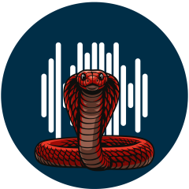
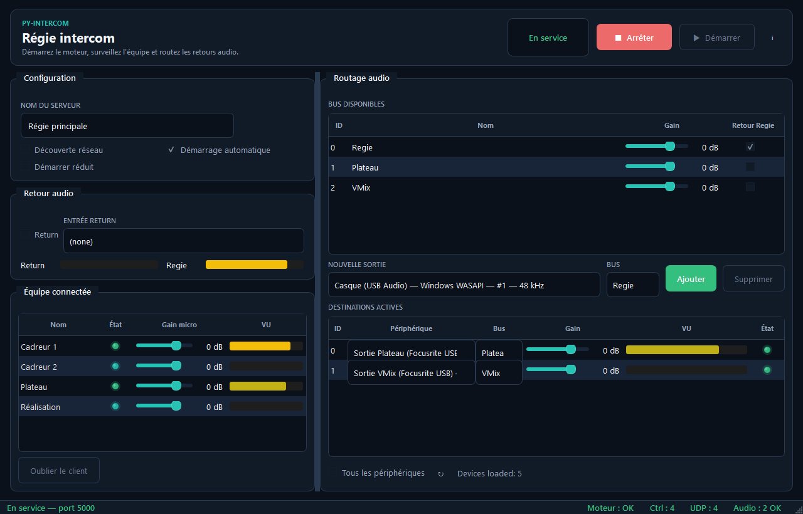
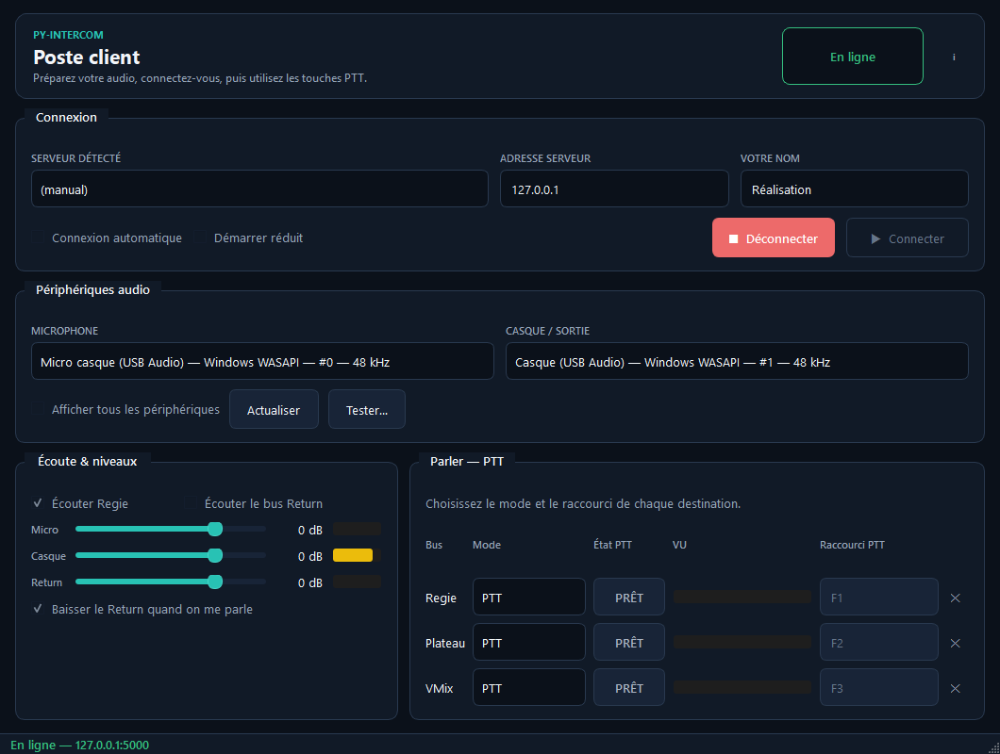
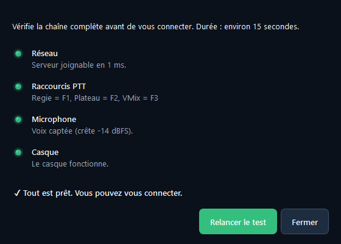
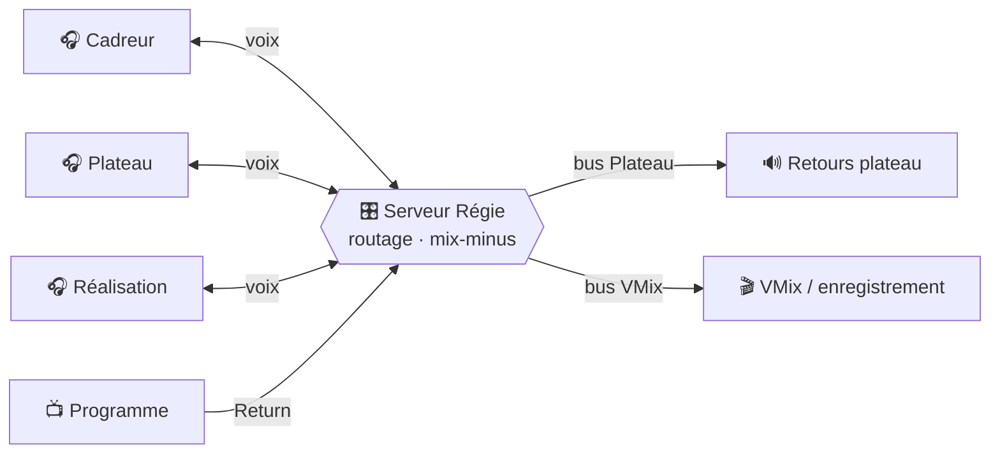

<div align="center">



# py-intercom

**L'intercom de régie, sur votre réseau local.**<br>
Push-to-talk, mix-minus et retours plateau en temps réel, avec de simples PC Windows.

[](https://github.com/lfpoulain/py-intercom/releases/latest)
[](https://github.com/lfpoulain/py-intercom/actions/workflows/release.yml)

[](LICENSE)

<br>

[](https://github.com/lfpoulain/py-intercom/releases/latest/download/py-intercom-server.exe)
&nbsp;
[](https://github.com/lfpoulain/py-intercom/releases/latest/download/py-intercom-client.exe)

<sub>Aucune installation : un fichier, un double-clic.</sub>

<br>



</div>

## ✨ Pourquoi py-intercom

<table>
<tr>
<td width="33%" valign="top">

### 🎙️ Push-to-talk par bus
Trois destinations : **Régie**, **Plateau** et **VMix**. Chaque bus a sa touche, en mode PTT, Toggle ou micro ouvert.

</td>
<td width="33%" valign="top">

### 🎧 Mix-minus automatique
Chaque opérateur entend l'équipe, jamais sa propre voix. Le programme peut s'ajouter en retour, avec un volume réglable.

</td>
<td width="33%" valign="top">

### ⚡ Temps réel avant tout
Opus 48 kHz, trames de 10 ms. Une dérive d'horloge ou une rafale réseau est rattrapée toute seule : le retard ne s'accumule jamais.

</td>
</tr>
<tr>
<td valign="top">

### 🔊 Sorties physiques
Le serveur envoie Plateau et VMix vers les cartes son de votre choix : retours de scène, régie vidéo, enregistrement.

</td>
<td valign="top">

### 🛡️ Sûr pendant le live
Aucune prise de parole fantôme : un micro ne s'ouvre que sur une session vérifiée, et tout PTT est relâché au moindre doute.

</td>
<td valign="top">

### 🩺 État lisible d'un coup d'œil
En ligne, dégradé, au repos : chaque client et chaque flux est visible, avec ses VU-mètres et ses diagnostics.

</td>
</tr>
</table>

## 🎬 Le poste client

<div align="center">

</div>

Choisissez le serveur (découvert automatiquement sur le réseau), votre micro et votre casque, puis parlez avec vos raccourcis.

<table>
<tr>
<td width="50%" valign="top">

### ✅ Tester avant le live
Le bouton **Tester…** vérifie en 15 secondes le réseau, les raccourcis PTT, le micro et le casque. Ce qui passe le test s'ouvrira à la connexion.

</td>
<td width="50%" valign="top">



</td>
</tr>
<tr>
<td colspan="2">

### 🔉 Le programme s'efface quand on vous parle
Option à cocher : pendant qu'on vous parle, le Return (le programme) baisse de 15 dB dans votre casque, puis remonte en douceur.

</td>
</tr>
</table>

## ⚙️ Comment ça marche



Une machine fait tourner le **serveur**, chaque opérateur lance un **client**. L'audio circule en UDP sur le réseau local ; une session de contrôle TCP doit être validée avant que le micro d'un poste ne puisse s'ouvrir.

## 🚀 Démarrer en 3 étapes

1. **Sur la machine Régie** : lancer `py-intercom-server.exe`, ajouter les sorties physiques, cliquer sur **Démarrer**.
2. **Sur chaque poste** : lancer `py-intercom-client.exe`, choisir le serveur, le micro et le casque, cliquer sur **Connecter**.
3. **Attendre « En ligne »**, régler les touches PTT, puis faire un tour de micro.

Ports utilisés : UDP 5000 (audio), TCP 5001 (contrôle), UDP 5002 (découverte). Le [guide d'exploitation](docs/guide-exploitation.md) couvre les gains, les casques Bluetooth et le dépannage.

## 📚 Documentation

| | Document | Contenu |
|---|---|---|
| 🎚️ | [Guide d'exploitation](docs/guide-exploitation.md) | Mise en place, PTT, gains, Bluetooth, dépannage |
| 🧭 | [Architecture](docs/architecture.md) | Organisation du code, threads, routage, latence |
| 📡 | [Protocole](docs/protocole.md) | Paquets audio UDP et contrôle TCP |
| 🛠️ | [Développement](docs/developpement.md) | Tests, lint, build, publication des versions |
| 🗺️ | [Roadmap](docs/roadmap.md) | Décisions, travaux ouverts, qualification |

## 🛠️ Lancer depuis les sources

Avec Python 3.11+ sous Windows, double-cliquer sur un lanceur de [`launchers/`](launchers) : l'environnement s'installe tout seul. Ou :

```powershell
python -m venv .venv
.\.venv\Scripts\python -m pip install -r requirements.txt
.\.venv\Scripts\python run_server.py   # ou run_client.py
```

Chaque push sur `main` est testé, construit et publié automatiquement en nouvelle version : voir [Développement](docs/developpement.md).

<details>
<summary><b>Organisation du dépôt</b></summary>

```text
src/py_intercom/   code de l'application (common/, server/, client/)
tests/             tests automatisés, sans carte son
launchers/         lanceurs Windows en double-clic
scripts/           build des exécutables et de la DLL Opus, captures d'écran
bin/               opus.dll (libopus 1.6.1) et son manifeste de build
docs/              documentation et images
```

</details>

## 📄 Licence

Distribué sous licence [CC BY-NC-ND 4.0](LICENSE). Dépendances et provenance de la DLL Opus : [THIRD_PARTY_NOTICES.md](THIRD_PARTY_NOTICES.md).

<div align="center"><sub>Fait pour les équipes de live. 🎬</sub></div>
